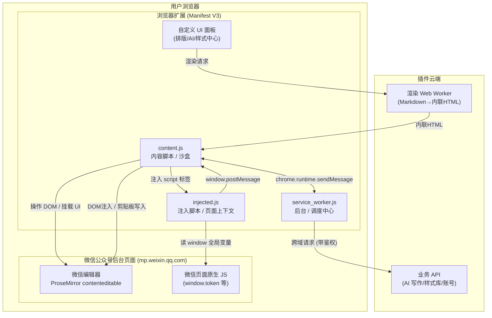
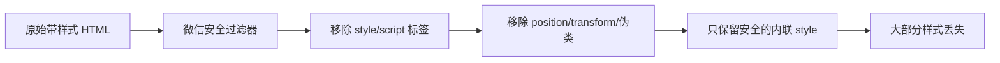
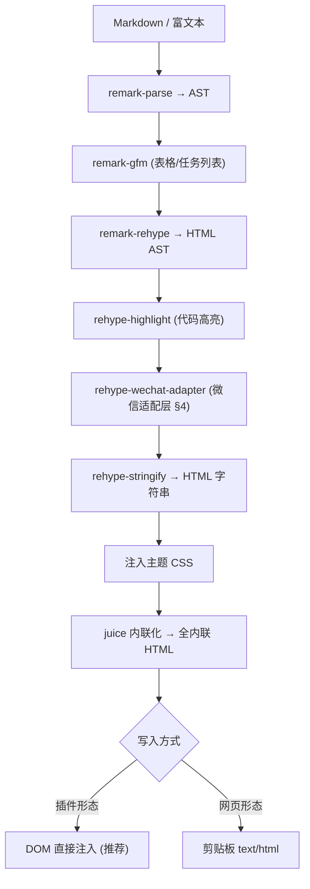

# 微信公众号编辑器插件 — 技术方案文档

> 用途：本文档作为 AI 编程助手（Cursor）的上下文，用于优化"在微信公众号官方编辑器中二次开发、并将插件内排版精准复制到编辑器"的浏览器扩展。
> 适用对象：以 Chrome Extension (Manifest V3) 形态注入 `https://mp.weixin.qq.com/*` 的第三方排版/AI 插件。
> 核心目标：①在官方编辑器中挂载自定义 UI 与功能；②让排版后的富文本在微信"内容清洗"机制下样式零丢失地写入编辑器。

---

## 0. 给 Cursor 的任务说明（请先读）

你正在优化一个微信公众号编辑器浏览器插件。请遵循本文档的架构约定与微信适配规则。关键约束：

1. **微信编辑器会清洗粘贴内容**：移除 `<style>`/`<script>`、`position`/`transform`/`animation`/伪类/媒体查询，只保留"安全的内联样式"。因此所有样式必须 **CSS 内联化** 写入元素 `style` 属性。
2. **微信编辑器是 ProseMirror 富文本引擎**（DOM 中可见 `ProseMirror-trailingBreak`、`ProseMirror-separator`）。直接 DOM 注入时必须触发 ProseMirror 能识别的输入事件，否则内容会被回滚。
3. **微信有 DOM 结构白名单**：违规结构会被编辑器静默删除。必须遵守 §4 的适配规则。
4. **优先复用成熟库**：`juice`（CSS 内联化）+ `unified/remark/rehype`（Markdown→HTML）。不要手写 CSS 内联化。

---

## 1. 整体架构

### 1.1 系统架构图



### 1.2 三脚本职责（Chrome Extension 标准分层）

| 脚本 | 运行环境 | 能力 | 限制 | 在本插件中的职责 |
|---|---|---|---|---|
| `content.js` | 隔离沙盒，共享页面 DOM | 读写微信编辑器 DOM、挂载 UI、调 `chrome.runtime` | 访问不到微信页面的 `window` 变量 | 挂载面板、监听编辑器、执行排版注入 |
| `injected.js` | 页面真实上下文，共享 `window` | 读微信全局变量(token)、带 Cookie 发请求 | 调不了扩展 API | 抓取 token / 与微信内部状态交互（按需） |
| `service_worker.js` | 扩展后台 | 跨域请求、消息中转、长任务 | 无 DOM | 调云端 AI/样式 API、规避 content 的同源限制 |

> 关键认知：`content.js` 与页面 JS **DOM 共享但 JS 隔离**。需要读微信 `window.xxx` 时，靠 `content.js` 动态插入 `<script src=injected.js>`，再用 `window.postMessage` 把数据传回。

### 1.3 manifest.json（MV3 参考）

```json
{
  "manifest_version": 3,
  "name": "公众号排版助手",
  "version": "1.0.0",
  "permissions": ["scripting", "storage", "clipboardWrite", "activeTab"],
  "host_permissions": ["https://mp.weixin.qq.com/*"],
  "background": { "service_worker": "service_worker.js" },
  "content_scripts": [
    {
      "matches": ["https://mp.weixin.qq.com/*"],
      "js": ["content.js"],
      "run_at": "document_idle"
    }
  ],
  "web_accessible_resources": [
    {
      "resources": ["injected.js"],
      "matches": ["https://mp.weixin.qq.com/*"]
    }
  ]
}
```

> 注意：`run_at: document_idle` 意味着**已打开的页面不会被注入，需刷新**。可在用户点击扩展图标时用 `chrome.scripting.executeScript` 做程序化补注入，避免强制刷新。

---

## 2. 排版精准复制管线（核心）

### 2.1 为什么普通复制会丢样式



**对策**：在写入前把所有 CSS 规则"内联化"到每个元素的 `style` 属性，绕过微信对 `<style>` 标签的剥离。

### 2.2 渲染管线（Markdown → 内联 HTML → 写入）



### 2.3 核心代码：CSS 内联化 + 双写入路径

```typescript
import juice from 'juice';
import { unified } from 'unified';
import remarkParse from 'remark-parse';
import remarkGfm from 'remark-gfm';
import remarkRehype from 'remark-rehype';
import rehypeHighlight from 'rehype-highlight';
import rehypeStringify from 'rehype-stringify';
import { rehypeWechatAdapter } from './adapters/wechat'; // 见 §4

/** Markdown → 内联化后的微信安全 HTML */
export async function renderForWechat(markdown: string, themeCss: string): Promise<string> {
  const processor = unified()
    .use(remarkParse)
    .use(remarkGfm)
    .use(remarkRehype)
    .use(rehypeHighlight)
    .use(rehypeWechatAdapter)   // 微信特殊适配，见 §4
    .use(rehypeStringify);

  const html = String(await processor.process(markdown));

  // 用唯一容器包裹，避免主题样式污染微信编辑器自身
  const wrapped = `<section id="mp-plugin-root">${html}</section>`;

  // 核心：把 themeCss 的所有规则写进每个元素的 style 属性
  return juice.inlineContent(wrapped, themeCss, {
    inlinePseudoElements: false, // 微信不支持伪元素
    preserveImportant: false,    // 微信暗黑模式依赖 !important，自己别加
  });
}
```

```typescript
/** 路径 A：剪贴板写入（网页工具用，需用户手动 Ctrl+V） */
export async function copyToClipboard(inlinedHtml: string): Promise<void> {
  const blob = new Blob([inlinedHtml], { type: 'text/html' });
  await navigator.clipboard.write([
    new ClipboardItem({ 'text/html': blob }),
  ]);
}
```

```typescript
/** 路径 B：DOM 直接注入（插件推荐，一键直插，无需粘贴）
 *  微信编辑器是 ProseMirror，直接改 innerHTML 会被回滚，
 *  必须通过 ClipboardEvent/paste 模拟，让 ProseMirror 走自己的解析。
 */
export function injectIntoWechatEditor(inlinedHtml: string): boolean {
  // 1. 定位编辑器 contenteditable 节点（选择器需可热更新，见 §5.1）
  const editor = document.querySelector<HTMLElement>(
    '#ueditor_0 .ProseMirror, [contenteditable="true"].rich_media_content, .js_editor_area [contenteditable="true"]'
  );
  if (!editor) return false;

  editor.focus();

  // 2. 构造剪贴板数据并派发 paste 事件，让 ProseMirror 用自身管线解析
  const dt = new DataTransfer();
  dt.setData('text/html', inlinedHtml);
  const pasteEvent = new ClipboardEvent('paste', {
    bubbles: true,
    cancelable: true,
    clipboardData: dt,
  });
  editor.dispatchEvent(pasteEvent);
  return true;
}
```

> **关键坑**：不要用 `editor.innerHTML = html` 直接覆盖。ProseMirror 维护自己的文档 state，直接改 DOM 会在下一次事务中被回滚或导致 state 不一致。务必走 `paste` 事件，让 ProseMirror 自己解析并入库。

### 2.4 渲染放进 Web Worker（长文档防卡顿）

```typescript
// markdown.worker.ts —— 计算密集型放后台线程
self.onmessage = async (e: MessageEvent<{ md: string; css: string }>) => {
  const html = await renderForWechat(e.data.md, e.data.css);
  self.postMessage({ html });
};
```

---

## 3. 在编辑器中挂载自定义 UI

```typescript
// content.js —— 等待编辑器就绪后挂载面板
function waitForEditor(cb: (editor: HTMLElement) => void) {
  const obs = new MutationObserver(() => {
    const editor = document.querySelector<HTMLElement>('[contenteditable="true"]');
    if (editor) { obs.disconnect(); cb(editor); }
  });
  obs.observe(document.body, { childList: true, subtree: true });
}

waitForEditor((editor) => {
  const panel = document.createElement('div');
  panel.id = 'mp-plugin-panel';
  panel.style.cssText = 'position:fixed;right:0;top:120px;z-index:9999;';
  // ... 渲染你的排版/AI/样式中心 UI
  document.body.appendChild(panel);
});
```

```typescript
// content.js ↔ injected.js 通信：读取微信页面 token
function injectPageScript() {
  const s = document.createElement('script');
  s.src = chrome.runtime.getURL('injected.js');
  (document.head || document.documentElement).appendChild(s);
}
window.addEventListener('message', (e) => {
  if (e.source !== window) return;
  if (e.data?.type === 'MP_TOKEN') {
    chrome.runtime.sendMessage({ type: 'SAVE_TOKEN', token: e.data.token });
  }
});
```

```javascript
// injected.js —— 运行在页面上下文，能读 window 全局变量
(function () {
  const token = window.wx?.commonData?.t || /* 视微信实际结构而定 */ null;
  window.postMessage({ type: 'MP_TOKEN', token }, '*');
})();
```

---

## 4. 微信编辑器适配层（rehype-wechat-adapter）

> 这是排版"精准"与否的分水岭。微信官方《编辑器插件开发规范》明确了结构白名单与样式限制，违规结构会被**静默删除**。

### 4.1 必须处理的 6 个微信坑

| # | 问题 | 现象 | 解决方案 |
|---|---|---|---|
| 1 | 连续空格被合并 | 代码缩进全乱 | 普通空格 → `\u00A0`（不间断空格） |
| 2 | 换行符失效 | 代码块 `\n` 不生效 | `\n` → `<br>` |
| 3 | 表单元素不支持 | 任务列表 checkbox 消失 | `<input checkbox>` → `☑` / `☐` |
| 4 | 外链弹"离开微信"警告 | 打断阅读 | 外链转文末脚注 `文字[1]` + 参考列表 |
| 5 | 字体不一致 | iOS 17+ 字号/字间距异常 | 不要设 `font-family`，用微信默认字体栈 |
| 6 | 结构违规被删 | 内容凭空消失 | 遵守 §4.3 DOM 白名单 |

### 4.2 适配层代码

```typescript
import { visit } from 'unist-util-visit';
import type { Root, Element, Text } from 'hast';

export function rehypeWechatAdapter() {
  return (tree: Root) => {
    visit(tree, 'element', (node: Element) => {
      // 坑5：移除所有 font-family，交还微信默认字体栈
      if (node.properties?.style) {
        node.properties.style = String(node.properties.style)
          .replace(/font-family\s*:[^;]+;?/gi, '')
          // 微信会过滤这些，提前清掉避免无效冗余
          .replace(/(position|transform|animation|transition)\s*:[^;]+;?/gi, '');
      }

      // 坑3：checkbox → Unicode
      if (node.tagName === 'input' && node.properties?.type === 'checkbox') {
        const checked = !!node.properties.checked;
        node.tagName = 'span';
        node.properties = {};
        node.children = [{ type: 'text', value: checked ? '☑ ' : '☐ ' } as Text];
      }

      // 坑1+2：代码块内空格/换行
      if (node.tagName === 'code' || node.tagName === 'pre') {
        visit(node, 'text', (t: Text) => {
          t.value = t.value
            .replace(/^( +)/gm, (s) => '\u00A0'.repeat(s.length))
            .replace(/\n/g, '<<BR>>'); // 占位，stringify 后替换为 <br>
        });
      }
    });
  };
}
```

```typescript
// 坑4：外链转脚注（在 stringify 前对 AST 做一遍收集 + 改写）
export function footnoteLinks(html: string): string {
  const refs: string[] = [];
  const out = html.replace(
    /<a[^>]+href="(https?:\/\/[^"]+)"[^>]*>(.*?)<\/a>/gi,
    (_m, url, text) => {
      refs.push(`${refs.length + 1}. ${text}: ${url}`);
      return `${text}<sup>[${refs.length}]</sup>`;
    }
  );
  if (!refs.length) return out;
  return out + `<section><hr/><p>参考链接</p><p>${refs.join('<br/>')}</p></section>`;
}
```

### 4.3 DOM 结构白名单（违规即被删，务必遵守）

| 规则 | 要求 |
|---|---|
| 相同标签嵌套深度 | ≤ 15 层 |
| `span[leaf]` 内部 | 只能放行内元素/文本（`span/strong/img`），**禁止**块级元素（`section/div/p`） |
| `section[nodeleaf]` 内部 | 只能放官方指定组件或 `img`，禁止其他块级元素 |
| 背景渐变 | 文字背景尽量不用渐变；多文本共享背景 → 包一个容器，背景写容器上 |
| `line-height` | 不要设 `0`（文字行重叠） |
| `height` | 不要设固定/`0`（移动端内容不可见） |
| `width` | 不要设固定宽度（破坏响应式） |
| `text-align` | 不要用 `start/end`（终端兼容性差），用 `left/center/right` |
| `<pre>` | 不要包普通段落（默认 `white-space:pre` 移动端截断），段落用 `<section>`/`<p>` |
| `!important` | 不要用（会让微信公共样式与暗黑模式算法失效） |

### 4.4 可用 / 不可用样式速查

```text
✅ 可用: color, background-color, font-size, font-weight, margin, padding,
        border, border-radius, text-align(left/center/right), line-height, box-shadow
❌ 不可用: position:absolute/fixed, transform, animation, :hover 等伪类,
        @media, 百分比单位 %(不稳定，改用 px), <style> 标签
经验法则：需要 JS 或 <style> 才能实现的效果，微信里基本都不行。
```

### 4.5 暗黑模式（Dark Mode）

```text
- 微信有深度优先遍历的 Dark Mode 算法，自动平衡文本/背景对比度。
- 跳过某节点转换：给该节点加 data-no-dark 属性（仅当前节点，后代内联样式仍会转换）。
- 别滥用 !important：暗黑模式算法依赖它做覆盖。
- 渐变背景上有文字时，算法会先 mix 成纯色再转换，结果不可控 → 尽量避免。
- SVG 不被算法处理：用 stroke="currentColor" fill="currentColor" 或加底色规避。
```

---

## 5. 工程实践与健壮性

### 5.1 应对微信改版（插件最大维护成本）

```typescript
// 把挂载点选择器做成可远程热更新的配置，改版时不必重新发版
const SELECTORS = await fetchRemoteConfig(); // 从云端拉最新选择器
const editor = querySelectorWithFallback(SELECTORS.editor); // 多候选 + 降级
```

- 选择器集中管理，支持云端热更新与多候选降级。
- 用 `MutationObserver` 而非一次性查询，适应编辑器异步渲染。
- 注入失败时给用户明确提示（如"请刷新页面"），而非静默失败。

### 5.2 发布前体检（微信官方验证 API）

微信提供结构验证接口，可在"一键排版/发布前"调用，提前发现会被删除的违规结构：

```typescript
// 通过 service_worker 调用（绕过 content.js 同源限制）
async function verifyArticleStructure(html: string) {
  const res = await fetch('http://mp.weixin.qq.com/article-bin/verify_article_structure', {
    method: 'POST',
    headers: { 'Content-Type': 'application/json' },
    body: JSON.stringify({ content: html }),
  });
  return res.json();
  // 返回: { isValid: boolean, inValidInfo?: { height/width/...: { violateRules, items:[{outerHTML}] } } }
}
```

> 这是一个差异化卖点：把它包装成"排版安全分 / 发布前体检"，在注入前先校验，命中违规则提示用户并自动修正。

### 5.3 测试清单

```text
[ ] 长文档(>1万字)渲染不卡顿（Web Worker 生效）
[ ] 代码块缩进/换行在微信预览正确
[ ] 任务列表 ☑/☐ 正常显示
[ ] 外链转脚注且不弹"离开微信"警告
[ ] 嵌套层级 ≤15，无内容被静默删除
[ ] 暗黑模式下文字/背景对比正常
[ ] iOS 与 Android 阅读端字体一致（未强设 font-family）
[ ] 微信改版后选择器降级生效或给出刷新提示
```

---

## 6. 推荐技术栈与目录结构

```bash
# 核心依赖
pnpm add juice unified remark-parse remark-gfm remark-rehype \
         rehype-stringify rehype-highlight unist-util-visit
# 可选
pnpm add remark-math rehype-katex rehype-sanitize
```

```text
src/
├── manifest.json
├── content.ts            # 挂载 UI、监听编辑器、执行注入
├── injected.ts           # 页面上下文，读 window 全局变量
├── service_worker.ts     # 跨域请求、验证 API、消息中转
├── ui/                   # 排版面板 / AI / 样式中心
├── lib/
│   ├── render.ts         # renderForWechat（§2.3）
│   ├── inject.ts         # injectIntoWechatEditor / copyToClipboard（§2.3）
│   ├── verify.ts         # 发布前体检（§5.2）
│   └── adapters/
│       └── wechat.ts     # rehype-wechat-adapter（§4.2）
├── workers/
│   └── markdown.worker.ts
├── config/
│   └── selectors.ts      # 可热更新的挂载点选择器（§5.1）
└── themes/
    ├── default.css
    └── elegant.css
```

---

## 7. 关键决策摘要（给 Cursor 的硬约束）

1. **样式必须内联化**（juice），绝不依赖 `<style>` 标签。
2. **DOM 注入走 paste 事件**，不要直接改 `innerHTML`（ProseMirror 会回滚）。
3. **必过适配层**（§4.2），处理空格/换行/checkbox/外链/字体。
4. **遵守 DOM 白名单**（§4.3），否则内容被静默删除。
5. **选择器可热更新**（§5.1），应对微信改版。
6. **发布前调验证 API**（§5.2）做体检。
7. **长文档用 Web Worker** 渲染，避免主线程卡顿。

---

## 参考资料

- 微信官方《公众平台编辑器插件开发规范》: https://developers.weixin.qq.com/doc/service/guide/product/plugin_spec.html
- 公众号排版工具样式复制粘贴原理（juice + 剪贴板 text/html 实测）: https://www.verysmallwoods.com/blog/20260119-wechat-markdown-copy-paste
- Chrome 内容脚本官方文档: https://developer.chrome.com/docs/extensions/develop/concepts/content-scripts
- injected.js 与 content.js 协作原理: https://blog.csdn.net/dubingxin/article/details/149600348
- 微信结构验证接口: http://mp.weixin.qq.com/article-bin/verify_article_structure
