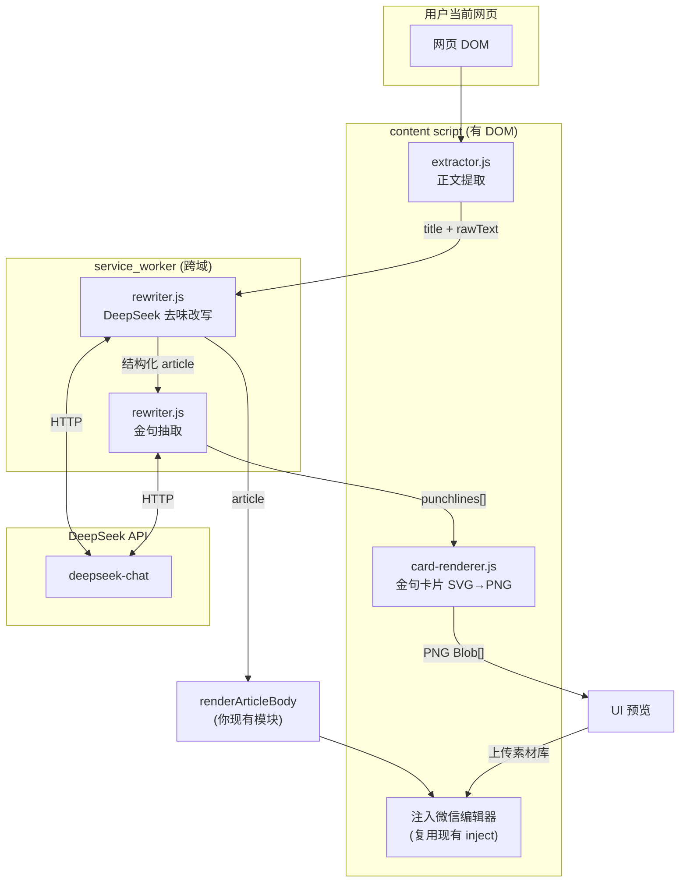

# 新功能方案：网页采集 → AI 去味改写 + 金句卡片

> 一句话：用户在任意网页点一下，插件采集正文，DeepSeek 改写成"有人味"的公众号文章，并自动生成可上传素材库的金句卡片图。
> 交付物：本方案文档 + 4 个可直接集成的模块（`extractor.js` / `rewriter.js` / `card-renderer.js` / `orchestrator.js`）。

---

## 0. 这个功能为什么值得做

它精准命中你前期研究里的两个最强切入点：

- **去 AI 味** —— 微信 2026 年严打"非真人自动化创作"，这是合规刚需，且定位"辅助真人"而非"替代真人"，安全。
- **金句卡片** —— 不烧文生图的钱，视觉统一、传播性强，是公众号涨粉的利器。

---

## 1. 整体架构与数据流



### 五步流水线

| 步骤 | 模块 | 环境 | 输入 → 输出 |
|---|---|---|---|
| 1 采集 | `extractor.js` | content | 当前页 DOM → `{title, rawText, images}` |
| 2 去味 | `rewriter.js` | service_worker | 原文 → 结构化 article（与你现有 `renderArticleBody` 对齐） |
| 3 金句 | `rewriter.js` | service_worker | 改写正文 → `punchlines[]` |
| 4 卡片 | `card-renderer.js` | content/UI | 金句 → PNG Blob[] |
| 5 注入 | 复用现有 | content | article→HTML 注入编辑器；卡片上传素材库 |

---

## 2. 模块说明

### 2.1 extractor.js — 正文提取
- 轻量可读性算法：候选容器按"文本密度 + `<p>` 数量 - 负面 class"打分，选最高分作正文根。
- 处理懒加载图片（`data-src`）、过滤小图标/广告位（宽度<200 跳过）、段落去重。
- **可升级**：鲁棒性要求更高时，换成 `@mozilla/readability`（Firefox 阅读模式同款），接口保持一致即可。

### 2.2 rewriter.js — 去 AI 味改写 + 金句抽取
- **核心是系统提示词** `HUMANIZE_SYSTEM_PROMPT`：明确禁用 AI 套话清单、要求句子长短交错、第一人称、保留事实不编造。这是功能成败的关键，要持续打磨。
- `temperature: 1.1` 略高，让文字更"活"。
- `response_format: json_object` 强约束输出，便于程序消费；并有 `safeParseJson` 容错。
- **模型可切换**：`DEEPSEEK_CONFIG` 抽成配置，将来换 Claude 只改这里 + headers。

### 2.3 card-renderer.js — 金句卡片
- **技术选型：SVG 排版 → Canvas 转 PNG**，不走文生图。理由：零成本、毫秒级、视觉 100% 可控、风格统一。
- 中文友好自动换行（按字宽估算，标点不放行首）、字数自适应字号、垂直居中。
- 3 套主题预设（editorial-green / cream / ink），与你的 `THEME_PRESETS` 体系对齐。
- 支持 `OffscreenCanvas`（可在 Worker 渲染）降级到普通 Canvas。
- ✅ 已实测渲染（见同目录 `card-preview.png`），中文排版正常。

### 2.4 orchestrator.js — 编排入口
- UI 只需调 `runCaptureToWechat()`，内部串起采集→后台改写→渲染卡片→返回预览。
- 文件底部注释给出了 `service_worker.js` 里消息监听的完整写法（含 `return true` 保持异步通道）。

---

## 3. 集成到现有插件的步骤

```bash
# 1. 放入项目
src/features/capture-rewrite/
  ├── extractor.js
  ├── rewriter.js
  ├── card-renderer.js
  └── orchestrator.js

# 2. service_worker.js 增加消息监听（见 orchestrator.js 底部注释）

# 3. UI 加一个按钮「一键采集并去味」，点击调 runCaptureToWechat()

# 4. 设置页加 DeepSeek API Key 输入，存到 chrome.storage.local
```

### 微信编辑器适配（复用前份技术方案）
- 改写后的 article → 你现有的 `renderArticleBody` + `decorateHtmlForTheme` → 走 `juice` 内联化 → 注入。
- 金句卡片 PNG → 走微信"上传图文消息内的图片"接口进素材库，拿到微信 CDN 的 `cdn_url` 再插入正文（外链图片微信会拦，必须转存）。

---

## 4. 合规与风控（重要）

| 风险 | 对策 |
|---|---|
| 采集他人原创内容 | 定位"改写参考"而非"搬运"；UI 提示用户对来源负责、标注引用 |
| 微信判定"非真人自动化" | 强调人机协作：改写后**强制用户预览编辑**再发布，不做"采集即自动发布" |
| AI 内容标注义务 | 可选自动加"本文由 AI 辅助创作"标注，符合平台告知要求 |
| 版权图片 | 金句卡片是自生成的原创图，无版权风险；原页图片复用需提示用户确认授权 |

> 设计红线：**绝不做"采集→生成→自动发布"的全自动闭环**（那正是被微信封禁的方向）。永远在"生成"和"发布"之间留一道人工确认。

---

## 5. 后续可扩展

1. **金句卡片多模板/品牌化**：让用户上传 logo、自定义配色，形成账号视觉资产。
2. **去 AI 味强度可调**：轻度/中度/重度三档，对应不同提示词。
3. **AI 味自检**：改写后再跑一次"AI 味评分"，给用户信心（呼应你的合规体检功能）。
4. **批量与历史**：采集历史、卡片库管理。

---

## 6. 依赖与备注

```bash
# 现有代码零新增运行时依赖（extractor/card-renderer 用原生 DOM/Canvas API）
# 可选升级：
pnpm add @mozilla/readability   # 更强的正文提取
```

- DeepSeek API 文档：https://api-docs.deepseek.com
- 正文提取参考 Readability 思路：https://github.com/mozilla/readability
- 金句卡片已实测预览图：见 `card-preview.png`
